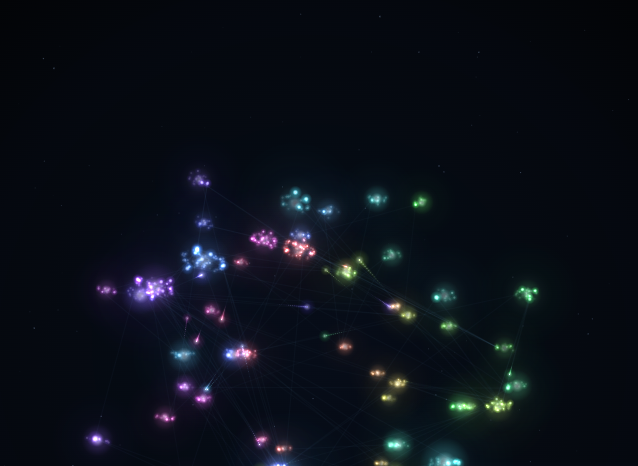
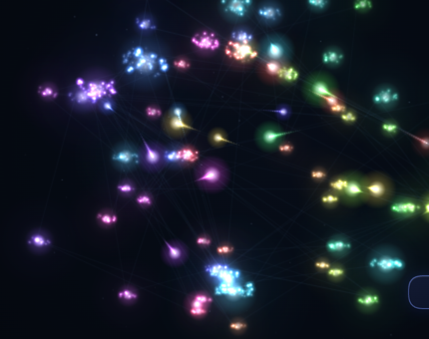
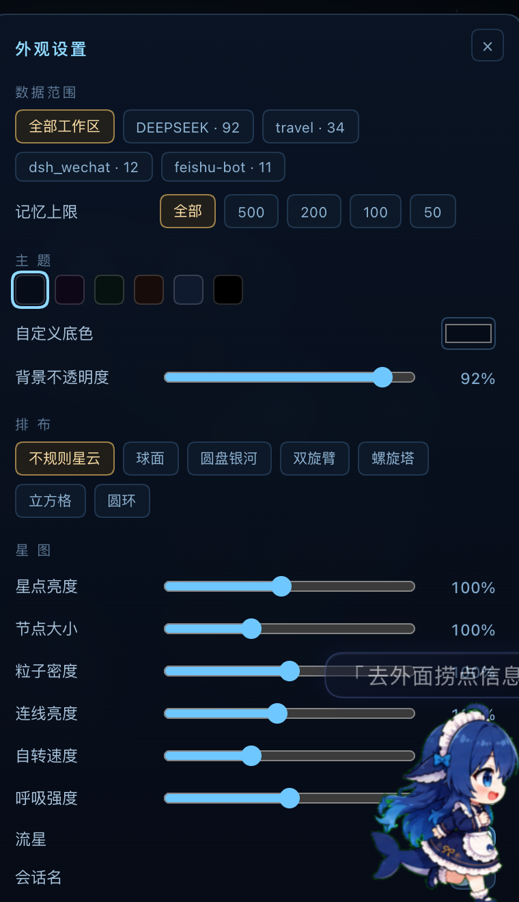

# 记忆星穹 · Memory Nebula

**你聊过的每一句话，都该变成一颗星。**

把 DeepSeek Harness 的历史会话铺成一张能旋转、能搜索的银河星图——而且助手随时能把记忆搜回来、读出来。



DSH 替你记住了每一轮对话，可这些记忆锁在 `~/.dsh/sessions` 里：你翻不到三个月前那句「就这么办」，也说不清当时到底是哪句话改了主意。

记忆星穹把它们全抽出来，铺成一片星系——**每个会话是一团星，每轮对话是一颗星，共享关键词的星之间连起光线。** 它不只是屏保：`nebula_search` 让助手一搜即回，点一颗星就能看回当时的原文。

> DeepSeek Harness 的第三方插件 · 纯本地运行 · 不联网、不上传

## 亮点

| | |
|---|---|
| 🪐 **一眼看见全部对话史** | 扫描 `~/.dsh/sessions`，剥掉工具调用与思考过程，一轮对话压成一条记忆；按会话分团、按时间排旋臂、按重要度定星等 |
| 🔍 **搜得到，也读得回** | 命中关键词的星脉冲发亮、其余变暗，点开看全文；助手用 `nebula_search` / `nebula_read` 直接检索原文 |
| ✍️ **记得住新的** | `nebula_remember` 把一件值得长期记住的事钉进星图，落在「手写记忆」星系；`/nebula` 让助手先接上记忆再回答 |
| 🎨 **七种排布 × 六套主题** | 不规则星云、球面、圆盘银河、双旋臂、螺旋塔、立方格、圆环；切换时星团会缓动飞过去 |
| 🔒 **纯本地** | 只读本机会话文件，缓存写在 `~/.dsh/memory-nebula/`，零网络请求 |

## 安装

需要 DSH 已装好、能正常启动。

**方式一：一条命令（推荐）**

```bash
dsh plugin add github:yhx19960607-max/dsh-memory-nebula
```

装完**重启一次 DSH**——Host 侧的工具和 `/nebula` 指令是在插件加载时注册的，重启后左侧栏才会出现「记忆星穹」。

**方式二：在插件页里装**

打开 DSH 的「插件」页 → 添加插件 → 填入同一个标识：

```
github:yhx19960607-max/dsh-memory-nebula
```

**方式三：下载压缩包离线装**

到 [Releases](https://github.com/yhx19960607-max/dsh-memory-nebula/releases) 下载 `dsh-memory-nebula-0.1.0.zip`，解压后：

```bash
dsh plugin add link:/解压出来的路径/dsh-memory-nebula
```

## 使用

1. 重启后点左侧「记忆星穹」。首次打开会扫描会话并铺图，几秒内完成。
2. 之后有新会话，点面板上的「重建」增量补进去。
3. 任意会话里输入 `/nebula`，或直接说「搜一下我们之前聊过的 XX」，助手会调用 `nebula_search`。
4. 拖拽旋转、滚轮缩放（相机推近，近处星团会明显放大）、点击星星看全文、双击复位。



## 设置

星图右上角「⚙ 设置」可调主题、自定义底色、背景不透明度、排布方式、星点亮度、节点大小、粒子密度、连线亮度、自转速度、呼吸强度、流星与会话名开关、左侧列表收起。设置存在浏览器 localStorage，刷新后保留，「恢复默认」一键回到初始状态。



## 数据与隐私

- 读取：`~/.dsh/sessions/**/session.v4.jsonl.zstd`（只读）
- 写入：`~/.dsh/memory-nebula/`（索引缓存与手写记忆）
- 不发起任何网络请求，不上传任何内容。HTTP 接口只接受本机 `127.0.0.1` 请求。

## 环境要求

- Node.js **≥ 22.15**（依赖 `node:zlib` 的 `zstdDecompressSync` 解多帧 zstd；开发测试于 v24）
- 一个能正常运行的 DSH，且会话记录已落盘

## 已知限制

- 只读已经落盘的会话；正在进行的对话要等落盘后才会出现。
- 关键词靠字边界统计自动发现，没有分词模型，个别标签会有噪声。
- 图谱为了可读性按会话限额取样，但搜索仍然覆盖全部记忆。
- Canvas 2D 手写投影，没有 WebGL 辉光；上千颗星时帧率会下降。

## 开发

```bash
git clone https://github.com/yhx19960607-max/dsh-memory-nebula.git
cd dsh-memory-nebula
node tests/selftest.mjs      # 自测，覆盖解码、索引、图谱、检索
dsh plugin add link:$PWD     # 本地联调（Host 侧改动后重启 DSH）
```

结构：

```
memory-nebula/
├── index.js            # Host：索引、HTTP API、工具、/nebula 指令
├── client.js           # Client：Canvas 3D 星图 + 搜索/详情面板
├── lib/
│   ├── transcript.js   # 多帧 zstd 解码、会话事件 → 回合
│   └── indexer.js      # 记忆、词边界词典、图谱、检索
├── cordis.patch.yml
├── locale/{en,zh}.json
├── icon.svg
└── docs/DETAIL.md
```

## English

**Memory Nebula** is a third-party plugin for [DeepSeek Harness](https://github.com/deepseek-ai) that turns your conversation history into a rotatable galaxy. Each session becomes a cluster, each turn a star, and links between stars come from shared keywords. The assistant can also search the graph back and read any memory in full via the `nebula_search` / `nebula_read` / `nebula_remember` tools and the `/nebula` command. Everything runs locally — no network requests, no uploads.

```bash
dsh plugin add github:yhx19960607-max/dsh-memory-nebula
```

Requires Node.js ≥ 22.15 and a running DSH. Restart DSH once after installing.

## 许可

[MIT](LICENSE)
